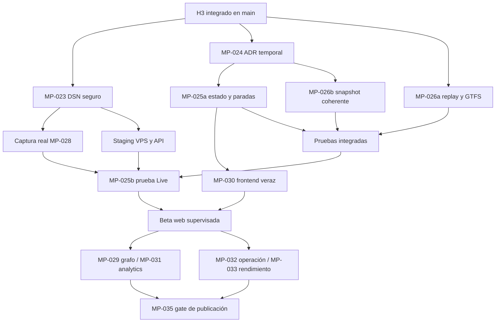

<!-- FUENTE IMPORTADA ÍNTEGRA — no editar el cuerpo. Solo esta cabecera es de gobernanza. -->
> **Nota de incorporación (2026-11-25).** Documento fuente recibido del propietario e incorporado sin alterar su contenido (todo lo que sigue a la primera línea `---` es el original byte a byte).
> - **Estatus:** PROPUESTA (2026-11-24), sin aprobar
> - **Fuente:** `MVP_LIVE_END_TO_END.md` (paquete `MADRID_PULSE_ORCA_GOBERNANZA_MVP_LIVE_DESIGN`)
> - **SHA-256 del original:** `d1172ebaba7c379791a3a8716c19026adcee0b63d418b352c36009f9ee803031`
> - **Alcance:** plan técnico hacia un MVP Live público; hechos verificados e hipótesis están separados en su §1
> - **Regla:** importar este documento **no** convierte sus recomendaciones en decisiones aprobadas. Las decisiones viven en `docs/DECISIONS.md` y `docs/adr/`; el estado vigente, en `docs/STATUS.md` y `docs/governance/PROJECT_STATE.json` (si el cuerpo menciona PROJECT_STATE.yaml, el fichero real es el .json).
> - **Privacidad:** el cuerpo conserva por integridad la formulación original, incluida alguna ruta absoluta local; excepción pendiente de decisión del propietario antes de fusionar.

---
# Madrid Pulse — Plan de ejecución hacia un MVP Live público

**Fecha:** 24 de noviembre de 2026  
**Base de análisis:** investigación adjunta «Madrid Pulse — Deep Research: arquitectura end-to-end, ingeniería de datos y estrategia de producto»; código público `pedromaaz13/madrid-pulse` (rama `main`, integración de H3 `7583ca5`); auditoría adversarial H3; código público de `gariasf/viapeninsula` y `electricitymaps/electricitymaps-contrib`; fuentes primarias citadas al final.  
**Estado de este documento:** propuesta técnica para aprobación. **No implementa, no contrata infraestructura y no autoriza despliegue por sí mismo.**  
**Producto objetivo:** un navegador carga una URL pública, muestra red de Madrid, información operativa actualizada desde Renfe, trenes que se mueven de forma ferroviariamente plausible donde exista geometría válida, horario como estimación explícita para servicios sin observación, estaciones/fichas y degradación honesta. Los modos históricos/analíticos evolucionan sobre la misma base.

## 0. Dictamen ejecutivo

**Decisión:** evolucionar la arquitectura existente, no reemplazarla. Mantener Python, GTFS/GTFS-RT, PostgreSQL/PostGIS, DuckDB/Parquet, FastAPI, React/TypeScript y MapLibre. Corregir los P0 de movimiento y replay; quitar defaults peligrosos; publicar la primera versión Live sobre una pila simple y supervisable; después automatizar el trazado con un grafo ferroviario offline y extraer snapshots compartidos si el tráfico lo justifica.

**Cambio fundamental de estrategia:** la demo estática D-01..D-06 puede aportar una primera URL, pero **no debe convertirse en el camino crítico hacia Live** ni en un segundo frontend divergente. Usar un contrato de estado compartido con adaptadores de transporte de datos: `static replay` y `live HTTP`, sin duplicar la lógica de presentación. Si la demo estática empieza a desviar esfuerzo de corregir FR-01/FR-02 y desplegar, priorizar el vertical slice Live supervisado.

**Tres reglas de producto:**
1. Un tren **observado** significa posición reportada por el operador con timestamp y calidad; **no** GPS continuamente confirmado por el usuario ni prueba de que todas las coordenadas sean físicamente exactas.
2. Un tren **estimado por horario** puede moverse suavemente por un recorrido **validado**, pero jamás etiquetarse como observado ni utilizarse como evidencia de puntualidad real. Si no existe recorrido fiable, no se dibuja un trayecto ficticio.
3. Un estado `STOPPED_AT`, una cancelación, una obsolescencia o un dato contradictorio gobiernan la representación. No gana siempre la fórmula que parece visualmente más suave.

## 1. Nivel de evidencia y restricciones

- **Verificado aquí en código del repositorio:** existen módulos de collector, API, contratos frontend, `ProgressEnvelope`, distinción `raw/map_matched/rendered`, `useSnapshot` con polling 10 s, `vite.config.ts`, persistencia GTFS y defaults de API/collector a `127.0.0.1:5433`. El cliente calcula `progressAt()` como avance lineal acotado y `frameFor()` transforma progreso a geometría cuando hay eje válido.
- **Reportado por auditoría H3, no reproducido en esta investigación:** 12 líneas, 42 rutas, 103 patrones, 95 estaciones; 28 patrones validados; 38,45 % de circulaciones con corredor; P0 FR-01 (avances falsos en `STOPPED_AT`) y FR-02 (`?at=` con edades negativas/`unknown`), 16 P1 y 24 P2; suites 283 Python + 89 frontend verdes pese a P0; `main` integrado, no Live público. Conservar evidencias, HEAD y pruebas de regresión originales.
- **Verificado en referencias:** Vía Península utiliza grafo de vías OSM, motor guiado por horario y reglas especiales de observación; su repositorio es AGPLv3. Electricity Maps `contrib` es AGPLv3; el frontend `contrib-rewrite` es histórico/archivado y no prueba la implementación comercial actual. Estudiar patrones, **no copiar código AGPL en código MIT** sin análisis legal.
- **Propuesta por validar:** máquina de estados, contrato segmentado, grafo offline, snapshots compartidos/CDN, infraestructura y objetivos SLO. Cualquier cifra de coste/cobertura no medida es hipótesis.

## 2. Inventario de decisiones KEEP / MODIFY / ADOPT / DEFER

| Área | Decisión | Acción verificable |
|---|---|---|
| GTFS Static + GTFS-RT Renfe | KEEP | Automatizar renovación/validez de GTFS; registrar `feed_published_at`, `received_at` y tiempo observado, sin confundirlos. |
| Collector Python cada 30 s | KEEP + HARDEN | Reinicios, métricas, backoff, lock o exclusión para doble collector, durabilidad y pruebas de ingesta. No polling cada segundo. |
| Normalización canónica + Quality Engine | KEEP + EXTEND | Anomalías de movimiento, inmovilidad, stale, estado contradictorio; pruebas con fixtures reales. |
| PostgreSQL + PostGIS | KEEP | DSN explícito obligatorio; acceso por red privada; transacciones consistentes; índice/perfilado cuando haya evidencia. |
| Parquet + DuckDB | KEEP | Retención hot/cold + backups externos + restauración probada; separar día civil de día de servicio. |
| API FastAPI y `/api/v1` | KEEP + FIX | FR-02 replay temporal, FR-07 snapshot consistente, manejo de freshness y versionado. |
| Catálogo GTFS de líneas/estaciones | KEEP + HARDEN | GTFS con vigencia; distinguir `stop` de `platform` cuando no hay información para afirmar andenes; exportar catálogo versionado. |
| Corredores OSM por relaciones | KEEP AS BASELINE | Mantener los 28 validados y registrar causas de exclusión; no proyectar sobre vías no verificadas. |
| Grafo ferroviario por extracto OSM | ADOPT AFTER POC | Construcción offline, trazado por secuencia de paradas/direccionalidad, validación y comparación contra baseline. |
| Motor `ProgressEnvelope` lineal | CHANGE | Enmendar ADR-0014; estado explícito + `hold/travel` por tramos o alternativa simple que supere los casos adversariales. |
| Posición `raw/matched/rendered` | KEEP | Contrato con timestamp, estado, fuente y confianza sin convertir heurística en probabilidad. |
| React/TypeScript/MapLibre | KEEP | Mapa persistente; navegación por entidad y tiempo compartidos; capas y estilos; pruebas de navegador. |
| Renderizado MapLibre `setData` | MEASURE THEN OPTIMIZE | Benchmark `setData` vs 30 Hz vs `updateData`; no reescribir por intuición. |
| OpenFreeMap | ADOPT MVP | Basemap con atribución, configurable, términos y disponibilidad sin SLA. No crear PMTiles propios en el MVP. |
| GitHub Pages | OPTIONAL INTERMEDIATE | Demo estática con replay seguro, no backend. No duplicar producto ni bloquear Live. |
| VPS + Docker Compose + Caddy | ADOPT FOR LIVE BETA | Un host / mismo origen / TLS / redes privadas / health / CI / backup. Revisar cotización y capacidad real antes de contratar. |
| R2 + snapshot publisher + CDN | DEFER UNTIL LOAD | Arquitectura recomendada para escalar, no prerrequisito para primeros visitantes. |
| WebSockets/SSE | DEFER | Polling HTTP es suficiente; animación se calcula en navegador con contratos válidos. |
| Kafka, Spark, Flink, K8s, dbt | DEFER/REJECT | Sin demanda que justifique ese coste operativo en el MVP. |
| Nuevas líneas y medios | FUTURE | Primero ampliar movimiento válido dentro de Cercanías Madrid; luego AV/LD/MD y, después, multimodal. |

## 3. Arquitectura recomendada: dos niveles, un solo producto

### 3.1. Primeras URLs (sin esperar al producto perfecto)

**Demo opcional, estática (`MVP 0`):** `GitHub Pages` sirve Vite/MapLibre y JSON de 90 min de observaciones *verificadas*; modo `REPLAY / Datos del día X`, sin un solo elemento anunciado como Live. No reutiliza la ruta `?at=` defectuosa. Las observaciones pueden saltar de posición entre muestras, sin interpolación ilegítima; se conserva el dato original y el timestamp. El exportador debe producir un manifest validado, catálogo y frames inmutables. No acoplar la UI a un contrato incompatible con Live.

**Beta Live prioritaria (`MVP 1`):** un VPS ejecuta `Caddy` + build estática React + `FastAPI` + collector + `PostgreSQL/PostGIS` + temporizador del archivador, y sirve frontend/API bajo **un mismo origen** (`/` y `/api/v1/`). El navegador consulta snapshots a cadencia próxima a la actual (10 s), el collector sondea Renfe según su frecuencia (30 s); el render puede animar a cada fotograma **únicamente el movimiento autorizado**. Caddy gestiona HTTPS y reverse proxy. DB privada, sin `5433` exterior. Datos históricos y backup en almacenamiento separado de la máquina cuando estén activos.

```text
                   Usuario (web o móvil)
                           │ HTTPS
                           ▼
                  URL propia / Caddy
                    ┌──────┴────────┐
                    ▼               ▼
              React/MapLibre    /api/v1 FastAPI
                    ▲               │
                    │ snapshots     ▼
                    └───────── PostgreSQL/PostGIS
                                    ▲
                  Renfe GTFS/GTFS-RT│
                         ▼          │
                       Collector ───┘
                                    │
                        Archive / Parquet
                                    │
                       Backup fuera del VPS
```

**Evolución de distribución:** cuando API/computación por visitante sea un cuello de botella, publicar catálogo estático versionado y un snapshot de estado **una sola vez por revisión** (R2/CDN o alternativa). Publicar artefactos inmutables primero, snapshot después y manifest `latest` al final. TTL corto, ETag, monotonicidad de revisión, validación de versión de catálogo, edad de datos y fallback al último estado **marcado obsoleto**. Cloudflare R2 necesita dominio personalizado para la modalidad de caché documentada; no asumir que `r2.dev` equivale a CDN.

### 3.2. Por qué no ir directamente a CDN/R2

Para los primeros usuarios, 10–30 s de polling de un snapshot relativamente pequeño contra FastAPI pueden ser suficientes si la generación se mide y evita recalcular geometrías costosas en cada request. Un publisher añade otra cadena de escritura/consistencia, claves, políticas de caché y distribución. Primero resolver FR-07, benchmark p50/p95 y 24 h de operación; después decidir si necesitamos cachear o desacoplar.

## 4. Motor ferroviario: especificación funcional prioritaria

### 4.1. Estados y procedencia independientes

**Estados operativos** propuestos: `SCHEDULED_NOT_OBSERVED`, `AT_ORIGIN`, `AT_STATION`, `MOVING`, `CANCELED`, `FINISHED`, `UNRESOLVED`. **Calidad** separada: `FRESH_OPERATOR`, `RECENT_OPERATOR`, `SCHEDULE_ESTIMATE`, `STALE`, `CONFLICT`, `UNLOCATED`. No confundir estado de tren y calidad del feed.

**Jerarquía prudente:** observación válida reciente y consistente del operador > proyección sobre corredor válido > estimación explícita por horario > último punto congelado marcado obsoleto. Ante contradicción reciente entre `STOPPED_AT` y posición que avanza, registrar discrepancia, comparar timestamps y evitar presentar una interpretación como certeza. `CANCELED` no aparece como circulación activa normal.

### 4.2. Reglas de movimiento mínimas

- Tren reportado `STOPPED_AT` en estación: **no autorizar avance** hasta una observación/estado posterior que sustente salida; no basta con que el horario teórico haya vencido.
- Tren antes de su primera salida: mantener en estación/origen; no extrapolar detrás/delante por desfase temporal erróneo.
- Horario sin GPS: movimiento `SCHEDULE_ESTIMATE` solo si existe corredor validado y servicio programado activo; visualización diferenciada (p. ej. símbolo hueco y trazo discontinuo), nunca fuente para puntualidad observada.
- En tránsito confirmado con corredor: construir progreso autorizado entre anclas y límites; no saltarse estaciones/esperas en el horizonte; si hacen falta múltiples tramos `hold/travel` versionar el contrato para compatibilidad con el frontend. El algoritmo de Python es autoridad, TypeScript evalúa ese contrato y prueba equivalencia.
- Al caducar: congelar o degradar visiblemente; no retroceder kilómetros ni resetear la edad al recuperar la fuente.
- Sin corredor válido: punto `RAW` con fuente y edad; no inventar proyección ni animarlo en línea recta entre coordenadas en tramos de vía desconocidos.
- Cambio de servicio: `24:xx`, fecha GTFS, zona `Europe/Madrid`, UTC/DST; tests de salto y de ida/vuelta temporal.

### 4.3. Contrato de respuesta orientativo (no copiarlo literalmente al código)

```json
{
  "movement_schema_version": "2",
  "operational_state": "AT_STATION",
  "quality_state": "FRESH_OPERATOR",
  "position_provenance": "operator_observation_projected_to_validated_track",
  "observation_at": "2026-11-24T10:00:00Z",
  "display_at": "2026-11-24T10:00:20Z",
  "valid_until": "2026-11-24T10:01:00Z",
  "segments": [
    {"kind": "hold", "from": "2026-11-24T10:00:00Z", "until": "2026-11-24T10:00:40Z", "progress_m": 1800}
  ]
}
```

El ejemplo no autoriza la salida al acabar `hold`: requiere decisión explícita de contrato basada en la evidencia de operación. Evitar que un `travel` generado automáticamente contradiga `STOPPED_AT`. No adoptar un contrato segmentado por sofisticación estética si una versión más simple supera todas las pruebas.

### 4.4. Pruebas obligatorias

- FR-01: los 28 `STOPPED_AT` del corte estudiado no se mueven falsamente; 17 antes de salida y otros casos con estado contradictorio.
- FR-03/04/05: paradas y cruces sin adelantos ficticios, saltos y regresiones acotados según casos de auditoría, sin apelar a un promedio que esconda fallos.
- FR-02: `?at=` solo lee datos disponibles hasta el instante solicitado; edades no negativas o política de ausencia documentada; reloj de replay íntegro.
- FR-07: collector/API no publican una `revision` que promete datos ausentes; usar transacción consistente / marcador correcto.
- FR-19: GTFS caducado detectado antes de funcionar con itinerarios inexistentes.
- Test contra `beb9434` **falla antes** y pasa después de la corrección. Verificar supuestos del arnés contra código de producción (180 s, no 190 s).
- Comparación Python↔TypeScript sobre las mismas anclas, paradas, estados y timestamps.
- Prueba adicional Live tras disponer de datos reales de varios días; las dos muestras separadas por 77 s no permiten calibrar comportamiento general.

## 5. GIS: de 28 corredores a una cobertura defendible

### 5.1. Qué NO significa el 28/103

Es **27,2 % de patrones** con geometría validada y **38,45 % de circulaciones programadas** sobre esos patrones en la muestra histórica de auditoría. No representa el porcentaje de GPS disponible ni el porcentaje de trenes confirmados en tiempo real. El catálogo incluye 12 líneas, pero únicamente 4 tenían movimiento sobre corredor validado. Declarar «12 líneas disponibles» exige aclarar que no implica movimiento validado de todas.

### 5.2. Dos mejoras con coste diferente

**Mejora rápida y controlada:** antes de crear un motor de grafos, ejecutar los fixes que la auditoría identificó como potencialmente recuperables: C4b con sentido invertido, tres caveats geométricos y un feed truncado, sin rebajar restricciones de trazado. Medir cobertura ponderada antes/después; el 43,35 % señalado en la auditoría es una hipótesis a reproducir, no un resultado garantizado.

**Mejora estructural:** evaluar un pipeline de grafo sobre extractos OSM de **Madrid** de Geofabrik (`madrid-latest.osm.pbf`), no necesariamente de toda España. Filtrar `railway=rail`, enlaces reales por nodos, gauge y access cuando están presentes, puentes/túneles, vías paralelas, sentido, restricciones de giro/ramal, nodos de estación y concordancia con GTFS. Usar `shapes.txt` solo si la fuente específica lo aporta y es suficientemente válido.

### 5.3. Prueba de concepto antes de migrar

Comparar **tres casos ferroviarios**, cada uno con un patrón GTFS y secuencia de paradas fijados:
1. C5, referencia ya validada.
2. C4b/ramal/direccionalidad ambigua.
3. Línea con vías compartidas (elegida según datos reales, no intuición).

Construir caminos candidatos sobre grafo y evaluarlos por: continuidad, orden monotónico de paradas, distancia estación-vía justificada, coste de longitud/desvío, sentidos, número de cambios de vía, distancia a geometría/observaciones verificadas y ausencia de saltos por túneles/nodos faltantes. Validar manualmente muestras de alto riesgo con mapas/OSM; comparar contra ruta baseline.

**Gate de adopción:** gana cobertura ponderada sin aumentar false matches ni cruzar huecos físicamente discontinuos; build determinista con versiones y hashes; tests por ramales; tolerancias dependientes de calidad de estación/OSM, no 150 m ciego. Si el grafo no mejora, conservar método actual y registrar causa.

**No migrar aún a pgRouting:** comenzar offline con Python+NetworkX (o estructura liviana propia) y pyosmium/Osmium/Shapely solo según necesitemos. PostgreSQL/PostGIS almacena e indexa los resultados, no necesita ejecutar el solver por request.

## 6. Frontend/UX: mapa que se entiende y parece un producto

### 6.1. Prioridad de UI antes de añadir gráficos

Un mapa *map-first* con selección estable `Train`, `Station`, `Line`; una fuente de tiempo compartida (Live/Replay/Explore); paneles conectados al mismo contexto. No introducir Jotai/TanStack por imitación de Electricity Maps si los hooks actuales permiten compartir contexto con complejidad baja.

**Primera beta obligatoria:**
- Fuente de teselas configurable, OpenFreeMap con atribución, sin precarga prohibida ni API key en navegador.
- Rótulos visibles «posición reportada por Renfe», «ajustada a la vía», «estimación por horario» y «sin datos recientes»; el sello de actualización se refiere a la entidad, no al timestamp de descarga del feed.
- Símbolos distintos para observado, programado y stale; cancelación diferenciada; no reportar velocidad estimada como medida.
- Ficha de tren con línea, destino, última observación, siguiente estación (si puede inferirse), condición de servicio, método de posición y calidad.
- Reducir superposición inicial de 25 grupos de trenes iguales: cluster/collision/offset declarativos sin mover la posición ferroviaria subyacente; hover o click para descubrir varias entidades.
- Selección de estación/tren y rango temporal preservados entre vistas, deep link con URL si aporta valor.
- Estado de carga/ausencia de WebGL/stale y móvil 390×844 comprobados en navegador real.
- El mapa **no es prueba de ruta correcta**. Comparar estaciones con trazo y secuencia en un panel de diagnóstico GIS; inspeccionar casos al cambiar sentido y ramal.

### 6.2. Rendimiento por evidencia

Mantener `requestAnimationFrame` y fuentes MapLibre. Crear presupuesto propio de rendimiento y Playwright reproducible: cold load, tiempo hasta líneas/trenes, frame gaps, memoria, FPS, respuesta de selección. Inspirarse en `viapeninsula/src/page/budget.json`, **sin copiar sus umbrales** ni afirmarlos como medidos por Madrid Pulse.

Primero benchmark con los ~100–200 vehículos realmente observados y casos sintéticos 500/1000. Comparar `setData()` actual, cadencia 30 Hz y `updateData()` incremental solo con IDs estables. Optimizar exclusivamente cuando las mediciones indiquen cuello de botella. No crear un renderer WebGL nuevo antes de probar estas alternativas.

## 7. Datos, API y analítica

**Collector**: mantener polling 30 s, timeout/reintentos, normalización y hash; añadir control de doble instancia, log por ciclo y cadencias reales medidas. Medir `age_gps`, `age_feed`, `age_ingest`, éxito de sondeo y cambios del feed; no interpretar observación repetida de un tren parado como feed caído.

**API**: corregir FR-02 y FR-07; versionar contrato de movimiento; cachear catálogo por ETag; snapshot `no-store` inicialmente si se genera dinámico, con medición real antes de shared snapshot publisher. Las respuestas deben indicar la cobertura por línea y versión de GTFS/OSM.

**Histórico**: mantener PostgreSQL operativo + Parquet comprimido; días de servicio, UTC, cambio DST y datos faltantes. Separar archivo frío y backup restaurable. No sumar sin más 258 MB/día de BD y 19 MB/día de Parquet como si fueran datasets independientes; son representaciones de parte de las mismas observaciones y tienen horizontes de retención diferentes.

**Analytics**: métricas nunca sin denominador y calidad: `observed_trip_coverage`, `geometry_coverage_by_trip`, `observation_freshness`, `station_match_accuracy`, `evaluated_on_time_pct`, `cancellation_reported_pct`; distinción observado/programado/cancelado/no observado. Persistir selección de línea/estación entre Live/History/Explore. SQL Lab, agentes IA, capa ontológica formal y modelado dimensional profundo: después de validar Live y tener histórico suficiente.

## 8. Infraestructura y seguridad: cómo publicar sin sobrearquitectura

### 8.1. Primer deployment Live recomendado

**Un VPS pequeño pero medido** (no elegir solo por €/mes), Docker Compose y Caddy:
- `frontend` build estática servida en `/`.
- `api` FastAPI solo detrás del proxy y healthchecks.
- `collector` single instance, reinicios, jitter y cuotas respetadas.
- `db` PostgreSQL/PostGIS en red privada y volumen persistente; sin puerto público.
- `archive` job programado, purga solo después de exportar/verificar, medidas contra carreras.
- `backup` **fuera del servidor**, con restauración probada.
- `metrics/logs` básico: health, errores, última ingesta, antigüedad y espacio disponible.
- GitHub Actions CI → build/artefacto → staging → smoke → release aprobado → producción.

**Requisitos previos no negociables:** MP-023 (DSN explícito); FR-01/02; protección de API (rate limit, CORS si origen separado, timeout); GTFS vigente; atribuciones; logs sin secrets; credenciales independientes por entorno; test de restauración; 24 h continuas para beta y 72 h como validación preferible antes de prometer fiabilidad.

### 8.2. Estimación de hardware y costes

No basar la compra en los 5–8 € del primer informe de Orca. En noviembre de 2026, Hetzner publica precios actualizados tras el ajuste de junio: CX23 en algunos mercados aparece ~5,49 €/mes sin IVA, mientras CPX22 puede ser ~19,49 €/mes sin IVA; ubicación, disponibilidad real, IP/volumen/backup y capacidad cambian la factura. **Pedir cotización actual y comprobación de RAM, CPU y disco antes de comprar.**

Empezar con objetivo de coste **~15–45 €/mes como presupuesto operativo de beta**, incluyendo márgenes para backups, almacenamiento remoto y dominio (estimación, no cotización). Considerar 4 GB RAM como mínimo candidato, 8 GB si la carga real de PostGIS/API/collector y archivado en el mismo host no es estable; evitar ejecutar jobs pesados del solver GIS en horas de máxima carga. El informe de 40 GB/22,6 GB no contabiliza por completo WAL, índices, logs, OS, Docker ni crecimiento imprevisto: preferir margen y purga verificada a una cuota de disco rígida.

### 8.3. Escalabilidad por métricas, no por temor

Al medir mucha concurrencia, separar: catálogo inmutable/CDN, `snapshot latest` generado una sola vez por ciclo, FastAPI para detalles e histórico y R2 para Parquet. Cloudflare R2 requiere configuración efectiva de caché (dominio personalizado). No introducir caché de snapshots inconsistentes antes de resolver FR-07. WebSockets opcionales solo si mediciones muestran que HTTP polling produce latencia inaceptable.

## 9. Roadmap priorizado, compatible con las tareas existentes

**No abrir otro Hito paralelo ni reemplazar la planificación `MP-023..MP-035`.** Usar esos IDs como columna vertebral. El plan de demo D-01..D-06 es opcional y debe compartir contratos del producto.

### Lote A — Seguridad + verdad ferroviaria (imprescindible para Live público)

| Trabajo existente | Dueño de ejecución | Revisor independiente | Condición de cierre |
|---|---|---|---|
| **MP-023** (H4-11) DSN seguro | Codex `gpt-6.2-sol` medium | Claude `claude-sonnet-5-5` high | Ausencia de variables falla antes de conectar; 5433 intacto; base efímera; regresión contra `beb9434`. |
| **MP-024** (H4-00) ADR-0014 | Claude `claude-opus-5-5` high | Codex `gpt-6.2-astra` high | ADR con alternativas, reglas STOPPED/estado/calidad, contrato temporal y aprobación humana antes de código. |
| **MP-026a** FR-02 + GTFS | Codex `gpt-6.2-sol` high | Claude `claude-sonnet-5-5` high | Replay `?at=` consistente; GTFS stale detectado; test red/green. Independiente de MP-024. |
| **MP-025a** FR-01 y paradas | Codex `gpt-6.2-astra` high | Claude `claude-opus-5-5` high | Cortes congelados sin movimientos falsos; 180 s reales; pruebas Python↔TS; regresiones. Depende de ADR aprobada. |
| **MP-026b** FR-07 consistencia snapshot | Codex `gpt-6.2-sol` high | Claude `claude-opus-5-5` high | Revisión de ingesta/snapshot coherente en carrera reproducible. Depende de la parte temporal ADR. |

### Lote B — URL pública y experiencia mínima (prioritario en paralelo cuando no pisa archivos)

| Trabajo | Ejecutor | Revisor | Criterio de cierre |
|---|---|---|---|
| **D-01..D-06** Demo estática opcional | Sonnet/Sol según plan local | Otro proveedor | URL estática con Replay verdadero y fecha fija, sin falsa interpolación; no obstaculiza Live ni usa contratos paralelos incompatibles. |
| **MP-027** Legal/README/tiles | Claude `claude-sonnet-5-5` medium | Codex `gpt-6.2-sol` medium | Atribuciones, límites, fuente de teselas, límites de datos, README honesto y release notes. |
| **MP-030** Frontend procedencia y estados | Codex `gpt-6.1-terra` medium/high (React/TS sin browser) | Claude `claude-sonnet-5-5` high (DevTools verificado) | Leyenda, fichas, estado/cancelaciones, captura desktop/móvil; no aprobación visual sin navegador real. |
| **LIVE-DEPLOY-A** (nuevo subalcance de MP-032, no tarea automática) Docker/Caddy/staging | Codex `gpt-6.2-sol` medium | Claude `claude-sonnet-5-5` high | URL staging HTTPS; API saludable; reinicios y secretos gestionados; DB no pública; backups restaurados. |
| **MP-028** Captura 2h × 3 días | Codex `gpt-6.2-sol` medium | Claude `claude-sonnet-5-5` high | Capturas con DSN efímero, calidad y cobertura por día; no bloquear el primer smoke de URL. |
| **MP-025b** Validación Live | Codex `gpt-6.2-astra` high | Claude `claude-opus-5-5` high | Pruebas temporales y geoespaciales sobre captura real; P0 cerrado para beta. |

### Lote C — Geometría y operación evolucionada (tras tener Live supervisado)

| Trabajo | Acción |
|---|---|
| **MP-029** | Mejoras sin rediseño (C4b, caveats), después PoC de grafo con 3 recorridos y gate comparativo; expandir líneas por cobertura ponderada. |
| **MP-031** | Métricas correctas con denominadores, histórico y selección contextual. |
| **MP-032** | Soak 24–72 h, health checks, operación, backups restaurables, documentos de runbook. |
| **MP-033** | Benchmark CPU/RAM/BD, p95 API, carga 1/10/50/100 usuarios; decidir pool y retención con mediciones. |
| **MP-034** | Registro de hallazgos estructurado, sin bloquear P0. |
| **MP-035** | Gate público integral con decisión humana GO/NO-GO, evidencias, URLs, SLO y costes. |

**Grafo completo, PMTiles propio, R2/CDN y experiencia analítica premium** pueden formar un siguiente conjunto de mejoras cuando ya exista beta Live. Si un nuevo P0 de GIS aparece en una línea prioritaria, se corrige antes de exhibir movimiento estimado de esa línea.

### DAG lógico compacto



## 10. Criterios concretos de MVP y gates

### Gate 0 — Primera URL de demostración
- URL HTTPS pública con render correcto en escritorio y móvil, sin login; fecha y origen explícitos.
- Tren observado solo en tramas válidas; estimaciones separadas o desactivadas; nunca false GPS o falsa ETA.
- Catálogo y líneas/estaciones disponibles; attribution y páginas legales.
- Playwright/browser real y tests de contrato; sin prometer Live.

### Gate 1 — Live técnico supervisado (staging)
- El collector completa ciclos reales y recupera caídas; no escribe en 5433 ni abre DB pública.
- API y frontend mismo origen y HTTPS; endpoints y healthchecks medibles.
- `FR-01` y `FR-02` reproducidos y corregidos, FR-07 y FR-19 verificados; `CANCELED`, `STOPPED_AT`, `STALE` no engañan.
- En el mapa se distinguen al menos tres casos: operador observado, posición proyectada de observación, estimación horaria; sin corredor solo punto RAW.
- Al menos una circulación observada en movimiento durante el ensayo y una parada declarada correctamente inmóvil; si no hay muestra, ejecutar replay con esa evidencia y declarar limitación de Live.
- Capturas y evidencias en navegador con sello de hora, y un ensayo de reinicio/recuperación.

### Gate 2 — Beta pública funcional (no equiparar a máxima cobertura)
- ≥24 h operativas monitorizadas sin errores graves no explicados; 72 h recomendado antes de prometer estabilidad.
- Backups externos y restore real en entorno desechable; retención activa; espacio libre con margen.
- `NO-GO` H3 reemplazado por dictamen nuevo basado en HEAD y evidencia, no borrado del histórico.
- Cobertura visible: 12 líneas catalogadas ≠ 12 con trazado completo; validado ~4 líneas inicialmente, mejora gradual.
- Seguridad básica: TLS, API privada detrás de proxy, rate limiting, secretos, logs, controles de abuso. Fuente legal/OSM/tiles atribuida.
- Puntuación de confianza no se muestra como probabilidad calibrada; timestamp del último dato operativo visible.
- El propietario aprueba publicar; métricas de uptime/latencia y costes quedan registrados.

### Métricas mínimas diarias
`collector_success_rate`, `feed_age_s`, `observation_age_s`, `last_good_snapshot_age_s`, `active_reported_trains`, `scheduled_estimates`, `stopped_movement_violations`, `spatial_jump_p95_m`, `validated_trip_coverage_pct`, `station_sequence_mismatch_count`, `api_snapshot_p95_ms`, `client_frame_gaps`, `db_disk_growth_mb_day`, `archive_growth_mb_day`, `restart_recovery_s`, `backup_restore_status`.

## 11. Cómo incorporar Vía Península y Electricity Maps sin perder el producto propio

**Vía Península — adoptar patrones:** grafo ferroviario y construcción offline; coste de vía/sentido, horario como movimiento base **solo cuando se etiqueta correctamente**, snap/hold explícito, estado por vehículo y presupuestos de rendimiento. **No copiar** `track.ts`/`engine.ts` AGPL al repo MIT. Probar algoritmo independiente con trazas propias y documentos de diseño.

**Electricity Maps — adoptar organización:** config declarativa por operador/fuente; contratos canónicos; selección geográfica+temporal compartida; detalle contextual y series históricas; dos planos de datos (estado global + consulta de entidad). No hacer depender el roadmap del frontend histórico archivado ni copiar fuentes AGPL. No introducir state management ajeno si los hooks y contextos existentes alcanzan.

**Madrid Pulse — conservar su diferencial:** histórico indefinido con presupuesto y retención propia, provenance `raw/matched/rendered`, QA ferroviaria, API pública versionada, métricas con denominadores, comparación entre operación y planificación.

## 12. Lo que expresamente posponemos

1. AV/LD/MD, Metro, EMT y BiciMAD: extensiones de adaptadores y producto después de beta fiable de Cercanías Madrid.
2. Grafo para España entera: antes demostrar tres casos Madrid y cobertura incremental.
3. PMTiles propio: útil cuando haya una razón de control/coste de teselas y capacidad operativa.
4. Rediseño visual total: primero procedencia, navegación, legibilidad, solapamiento y rendimiento medible.
5. Agentes IA, ontología formal, SQL Lab público, modelos predictivos y dashboard empresarial: después de histórico suficiente y confianza ferroviaria.
6. Kafka, WebSockets, microservicios/Kubernetes y warehouse distribuido: sin necesidad demostrada.
7. Optimizar API con R2 antes de solucionar snapshots inconsistentes.

## 13. Protocolo de ejecución y responsabilidades de Orca

- Coordinador `claude-sonnet-5-5` medium. Cada tarea debe identificar exactamente HEAD, worktree, archivos permitidos, dependencias y tests. No comenzar el siguiente lote sin los gates definidos.
- Executor/reviewer de **proveedores distintos**, ambos capaces de inspeccionar el mismo HEAD. Claude Sonnet High para revisión visual con DevTools realmente disponible; Codex Terra sin navegador **no** da visto bueno visual.
- Opus `claude-opus-5-5` high para ADR temporal; Astra `gpt-6.2-astra` high para movimiento/geometría; Sol `gpt-6.2-sol` medium/high para API, DB, Docker, CI y tests. Escalar a xhigh solo con diagnóstico de bloqueo.
- No repetir auditoría H3; usar su `FINDINGS_REGISTER.md`, scripts reproducibles y baseline `beb9434`. Prueba red/green obligatoria para P0. Revisar constantes y fixtures del arnés contra implementación de producción.
- Una primera revisión completa (bloqueantes vs recomendaciones), una ronda ordinaria de corrección/verificación adicional, después bloqueo/escalado. Sin revisiones infinitas.
- Preflight obligatorio antes de cualquier prueba que pueda escribir: DSN, puerto, host, aislamiento y permisos; nunca BD persistente 5433 ni sobrescritura de archivos fuente.
- Despachos pesados limitados (máximo 2 simultáneos por proveedor, preferiblemente menos en Mac local); registrar modelo y esfuerzo efectivo, coste cuando se pueda medir.
- Push/PR/merge y contratación infra: según permisos vigentes y gates humanos. Publicar URL Live requiere aprobación nueva; no extrapolar autorizaciones del MVP0.

## 14. Instrucción ejecutiva que se puede enviar a Orca

> **Incorpora este plan como propuesta de modificación del Hito 4 existente, no como un backlog nuevo.** Primero reconcilia con `docs/H4_MP_MAPPING.md`, `docs/H4_TASK_MATRIX.md` y `docs/deployment/MVP0_IMPLEMENTATION_PLAN.md` local. Si esos documentos locales difieren de `main`, declara la diferencia. Propón la ruta crítica corta hacia un MVP Live en URL: MP-023 → MP-024/MP-026a → MP-025a/MP-026b → MP-030 + staging VPS → MP-028/MP-025b → gate público. Mantén D-01..D-06 únicamente si la demo estática conserva el contrato común y no retrasa la ruta Live. Aporta un diagrama de despliegue, matrices de riesgo, tests que fallen en `beb9434`, un trabajo GIS de PoC separado (3 itinerarios) y un backlog único con responsables, costes y gates. **No reescribas Python/FastAPI/React/PostGIS, no migres a Workers, no implementes R2/PMTiles de primeras y no inventes cobertura geométrica.** Preparar el plan no autoriza contratar ni publicar Live; usar aprobación explícita del propietario.

## 15. Fuentes verificadas y referencias

- Código Madrid Pulse: https://github.com/pedromaaz13/madrid-pulse
- Baseline de auditoría: https://github.com/pedromaaz13/madrid-pulse/blob/main/docs/audits/hito-03/AUDIT_EXECUTIVE_DECISION.md
- Plan MP-023+: https://github.com/pedromaaz13/madrid-pulse/blob/main/docs/H4_MP_MAPPING.md
- Motor cliente `movement.ts`: https://github.com/pedromaaz13/madrid-pulse/blob/main/apps/web/src/domain/movement.ts
- Contrato Python `rendering.py`: https://github.com/pedromaaz13/madrid-pulse/blob/main/packages/movement/rendering.py
- API config: https://github.com/pedromaaz13/madrid-pulse/blob/main/apps/api/config.py
- Collector config: https://github.com/pedromaaz13/madrid-pulse/blob/main/services/collector/config.py
- Vía Península, trazado: https://github.com/gariasf/viapeninsula/blob/main/src/build/track.ts
- Vía Península, motor horario: https://github.com/gariasf/viapeninsula/blob/main/src/engine.ts
- Vía Península, performance budget: https://github.com/gariasf/viapeninsula/blob/main/src/page/budget.json
- Electricity Maps configuración de zona: https://github.com/electricitymaps/electricitymaps-contrib/blob/master/config/zones/ES.yaml
- Electricity Maps frontend histórico: https://github.com/electricitymaps/electricitymaps-contrib-rewrite/tree/master/web
- GTFS-RT: https://gtfs.org/documentation/realtime/realtime-best-practices/
- OpenFreeMap: https://openfreemap.org/ ; términos: https://openfreemap.org/tos/
- Geofabrik Madrid PBF: https://download.geofabrik.de/europe/spain/madrid/
- Vite static deploy: https://vite.dev/guide/static-deploy
- Cloudflare R2/CDN: https://developers.cloudflare.com/cache/interaction-cloudflare-products/r2/
- Renfe Data legal: https://data.renfe.com/legal
- Hetzner price adjustment June 2026: https://docs.hetzner.com/general/infrastructure-and-availability/price-adjustment/

**Limitación:** no he ejecutado el software ni el collector, ni una prueba de rendimiento o carga en infraestructura pública. La rama `docs/mvp-web-deployment` descrita por Orca es local y no estaba publicada cuando se consultó; sus documentos fueron considerados a partir del resumen proporcionado, no inspeccionados directamente en GitHub. Las fases, objetivos y costes son propuesta y deberán validarse con implementación y pruebas.
